# Resumen del proyecto: Red de incendios en Colombia (Grupo 5, NS4DA)

## La pregunta

Los incendios forestales en Colombia no ocurren aislados: municipios cercanos suelen quemarse al mismo tiempo. Nos preguntamos dos cosas:

1. ¿Qué municipios **conectan** ese riesgo?
2. ¿El fenómeno de **El Niño** (más seco) lo vuelve más conectado que **La Niña** (más lluvioso)?

El trabajo se repartió en tres paquetes, uno detrás de otro:

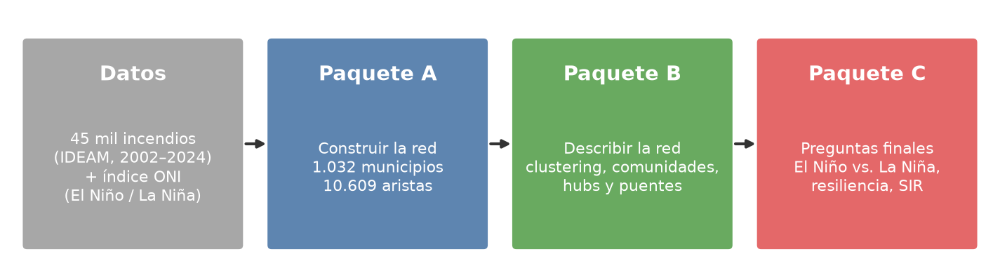

---

## Paquete A: construir la red

**Datos:** 45 mil registros de incendios del IDEAM (2002–2024) y el índice ONI de la NOAA, que dice si cada mes fue El Niño, La Niña o neutral.

**Regla para armar la red:**
- Cada **nodo** es un municipio, ubicado en el centro de su territorio.
- Dos municipios se unen con una **arista** si están a menos de 50 km y tuvieron incendios el mismo mes.
- El **peso** de la arista es en cuántos meses coincidieron.

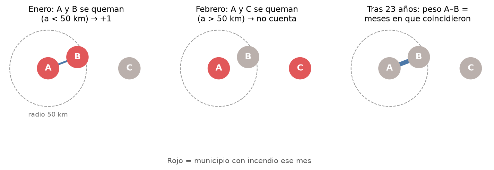

> **Analogía:** si dos casas vecinas se inundan el mismo día, no es que una inunde a la otra: llovió sobre las dos. Igual aquí: una arista dice "se queman juntos", **no** "el fuego pasó de uno al otro". Es co-ocurrencia, no contagio físico.

**Resultado:** una red de **1.032 municipios y 10.609 aristas**, más una red por fase (El Niño, La Niña y neutral), todas con los mismos municipios para poder compararlas.

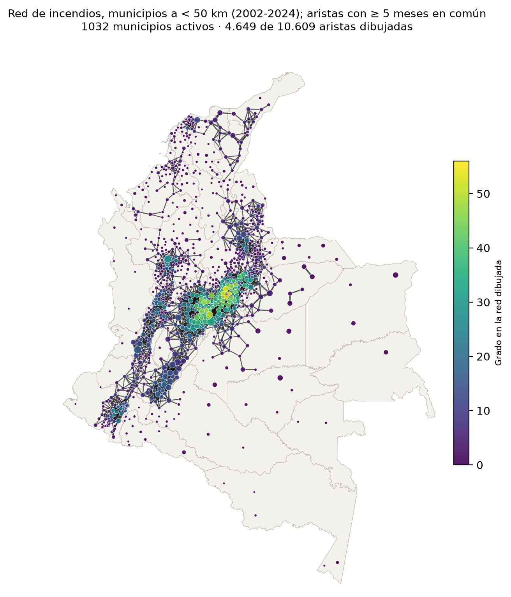

---

## Paquete B: describir la red

### Es una red "de barrio", no un "mundo pequeño"

- **Clustering de 0,56**, frente a 0,02–0,04 en redes aleatorias del mismo tamaño. Si dos municipios comparten un vecino, casi seguro también son vecinos entre sí.
- Pero los **caminos son unas 4 veces más largos** que en una red aleatoria.

> **Analogía:** es como un barrio: tus vecinos también se conocen entre ellos, pero para cruzar la ciudad tienes que recorrer calle por calle; no hay "aviones" que salten de un extremo a otro. Eso es una **red espacial**.

### No es solo la temporada seca

Al **barajar los años** (modelos nulos), la co-ocurrencia cae a la mitad. Los vecinos no solo coinciden en los meses secos de cada año: coinciden en los **mismos años**. Esa fue la primera pista de que El Niño importa.

> **Analogía del barajado:** si sospechas que una mano de cartas no es suerte, barajas mil veces y miras si alguna vez sale algo parecido. Si nunca sale, no fue suerte.

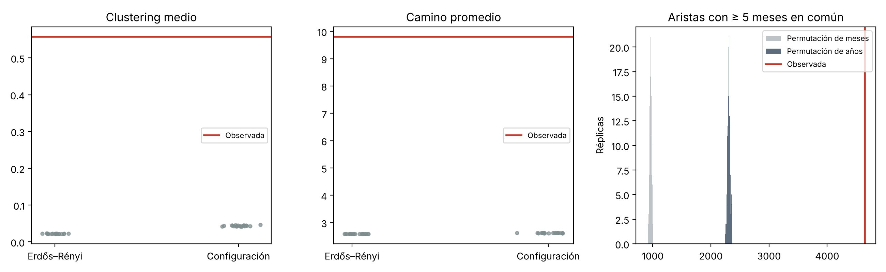

### 16 regiones de riesgo

Con el algoritmo de Louvain se encontraron **16 comunidades**, con modularidad alta (0,77). Siguen la geografía pero **cruzan departamentos**, por ejemplo Cundinamarca con Tolima o Santander con Boyacá.

> **Analogía:** son como cuencas de un río: el agua no respeta las fronteras políticas, y el riesgo tampoco.

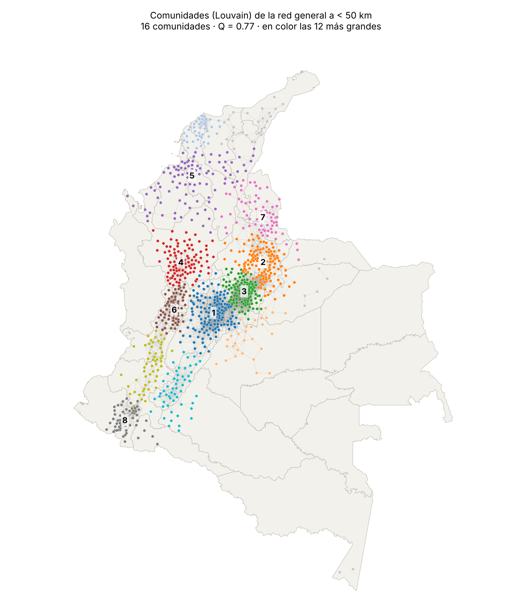

### Hubs y puentes son municipios distintos

| | Qué los define | Dónde están |
|---|---|---|
| **Hubs** | Más vecinos (grado) | Altiplano cundiboyacense: Samacá, Tunja, Ventaquemada… |
| **Puentes** | Más caminos pasan por ellos (intermediación) | Corredor Cesar–Magdalena Medio–Córdoba: San Alberto, Sabana de Torres… |

Ningún municipio es las dos cosas a la vez. Esta diferencia es la clave del resto del proyecto:

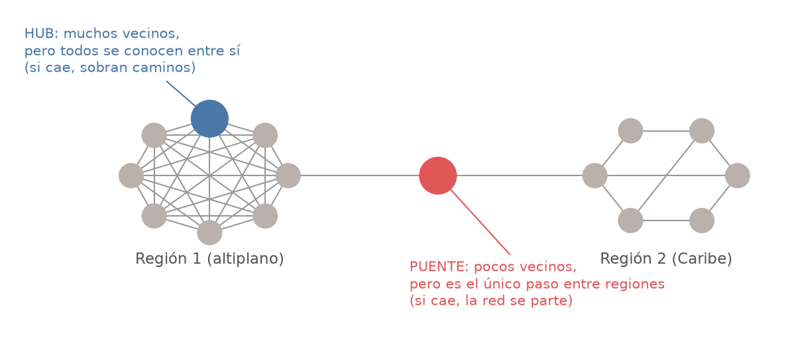

> **Analogía:** el hub es la plaza más concurrida del pueblo. Si la cierras, la gente da la vuelta por las calles de al lado. El puente es el único puente sobre el río: tiene poco tráfico local, pero si lo cierras, las dos orillas quedan incomunicadas.

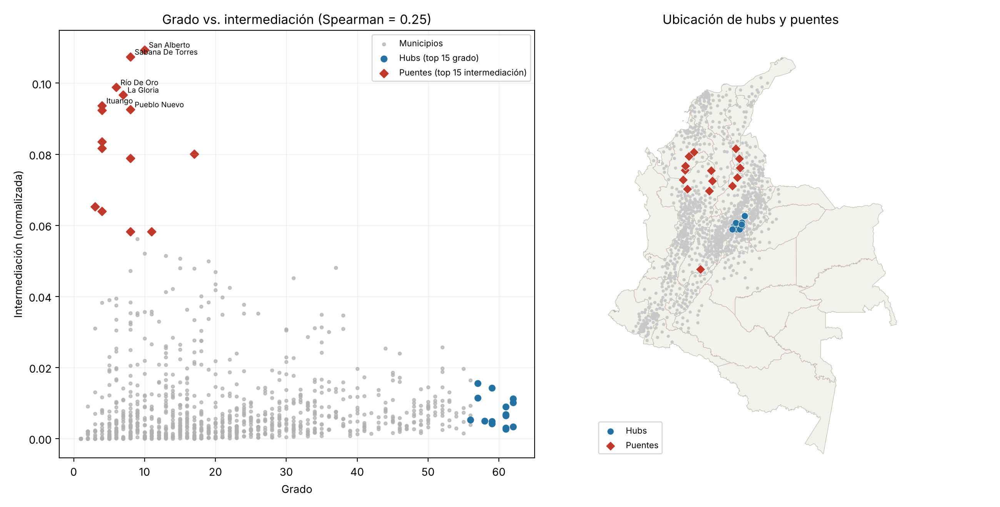

---

## Paquete C: las preguntas finales

### 1. ¿El Niño conecta más el riesgo? Sí

| | El Niño | La Niña |
|---|---|---|
| Municipios con incendio por mes | **97** | **41** |
| Aristas | 9.543 | 3.456 |
| Municipios en la red principal | **92 %** | **56 %** |
| Grupos separados | 4 | 13 |

En La Niña el Caribe queda aislado (naranja). En El Niño se une a los Andes, justamente a través de los puentes del Cesar y Córdoba.

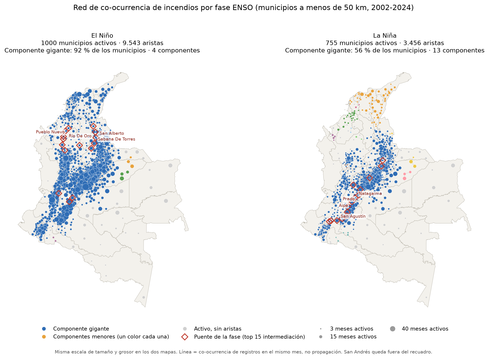

> **Analogía de la fiesta:** con 97 invitados en el salón, todos terminan conectados por alguien en común. Con 41, se forman corrillos separados. El Niño no cambia **cómo** se relacionan los municipios, sino **cuántos** se queman a la vez, y como están cerca, eso los une en una sola red.

### 2. ¿Podría ser casualidad? No

Hicimos una **prueba de permutación**: reasignamos al azar la etiqueta de fase de cada mes, mil veces. Se hizo de tres formas, para descartar explicaciones alternativas:

| Versión | Qué controla | Analogía |
|---|---|---|
| Libre | Nada (la más simple) | Barajar todas las cartas |
| Por mes del año | La temporada seca | Barajar solo eneros con eneros, febreros con febreros… |
| Por año | Que el IDEAM reporta cada vez más incendios | Barajar solo dentro del mismo año |

En las tres, la diferencia real (línea roja) quedó **por fuera de las mil permutaciones** (p ≤ 0,002). También se mantiene si quitamos 2023–2024, que tienen un reporte atípico.

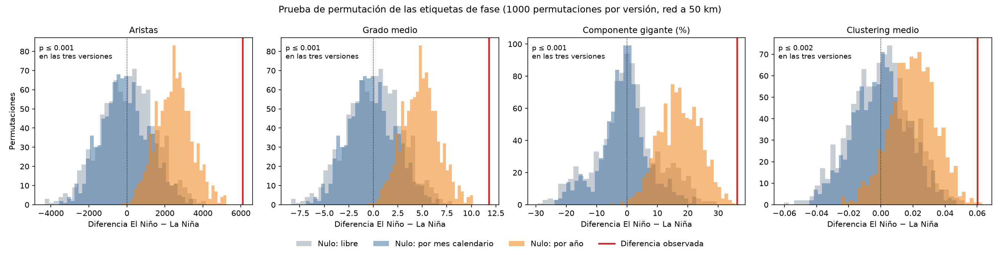

### 3. Resiliencia: ¿qué pasa si quitamos municipios?

Quitamos municipios uno por uno y medimos cuánto queda de la red principal:

- **Al azar o por hubs:** hay que quitar **casi la mitad** (~46 %) para partir la red.
- **Por puentes:** basta con quitar **el 5 %**.

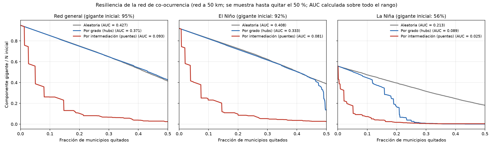

> **Analogía:** en una ciudad, cerrar calles al azar casi no afecta: siempre hay otra ruta. Cerrar los pocos puentes sobre el río la parte en dos de inmediato. Los hubs del altiplano son "redundantes": están tan rodeados de vecinos que cada uno tiene muchos reemplazos.

La Niña es mucho más frágil, porque ya empieza partida.

### 4. Difusión (modelo SIR): ¿puede el riesgo "propagarse"?

Simulamos un modelo de contagio, como los de epidemias, donde cada municipio pasa por tres estados: **S**usceptible → **I**nfectado (con incendio) → **R**ecuperado. Los parámetros **no se inventaron**, se calibraron con los datos:

- **γ (recuperación):** un municipio activo sigue activo al mes siguiente el 35 % de las veces, así que un episodio dura en promedio un mes y medio.
- **β (contagio):** la probabilidad de activarse sube de 2,2 % sin vecinos activos a 5,2 % con uno, 7,3 % con dos y 9,3 % con tres. Eso da β ≈ 0,02 por vecino.

**El umbral de propagación:**

| Fase | Transmisibilidad / umbral | Brotes grandes |
|---|---|---|
| El Niño | **1,03** (justo por encima) | 7,2 % de las simulaciones |
| La Niña | **0,71** (por debajo) | 0,4 % |

> **Analogía:** es como un fósforo sobre papel. Si el papel está húmedo (por debajo del umbral), la llama se apaga sola. Si está seco (por encima), se esparce. Con El Niño, la red queda justo del lado "seco".

**¿A quién "vacunar" (priorizar en prevención)?**

- Vacunar **50 hubs** reduce el tamaño medio de los brotes en **~70 %**.
- Vacunar **50 puentes** no lo reduce más que vacunar al azar.

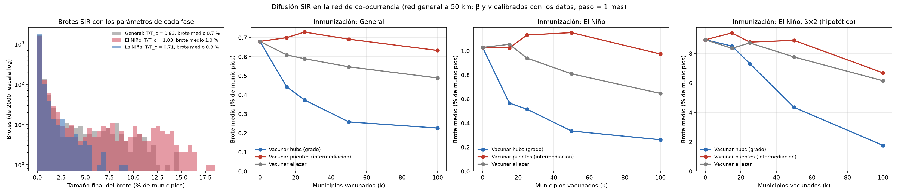

### ¿Por qué hubs y puentes dan resultados opuestos?

Parece una contradicción, pero responden **objetivos distintos**:

| Objetivo | A quién proteger | Por qué |
|---|---|---|
| Que cada brote afecte a **menos municipios** | **Hubs** del altiplano | Ahí nacen y crecen los brotes: es la zona con más vecinos para contagiar |
| Que las **regiones no se conecten** entre sí | **Puentes** del corredor Cesar–Córdoba | Son el único paso entre el Caribe y los Andes |

> **Analogía de la gripe:** para que se enferme menos gente, vacunas a los más sociables (hubs). Para que no pase de una ciudad a otra, controlas la carretera que las une (puentes). Cerrar la carretera no hace que en cada ciudad haya menos enfermos.

---

## Conclusión en una frase

**El Niño sí conecta el riesgo de incendio en Colombia:** no cambia cómo se relacionan los municipios, sino cuántos se queman a la vez. Así la red pasa de estar partida en regiones a ser casi una sola red nacional, justo por encima del umbral de propagación.

**Recomendaciones:**
1. En años de El Niño, reforzar la prevención en el **altiplano cundiboyacense** para reducir el tamaño de los brotes.
2. Vigilar el corredor **Cesar–Magdalena Medio–Córdoba** para que las regiones no se conecten.
3. Usar el **índice ONI como alerta temprana**: El Niño se anuncia con meses de anticipación.

**Limitaciones:**
- Una arista es co-ocurrencia, no propagación física del fuego.
- β mezcla contagio real con causas comunes, como el mismo clima seco.
- El reporte del IDEAM crece con los años. Esto se controló con la permutación por año.

---

## Entregables

| Archivo | Qué es |
|---|---|
| [PIF-NS4DA-5.ipynb](PIF-NS4DA-5.ipynb) | Informe final (la versión oficial es la de Colab) |
| [Grupo5_Final_NS4DA.pptx](Grupo5_Final_NS4DA.pptx) | Presentación de 10 diapositivas |
| [paquete_C/guion_presentacion_final.md](paquete_C/guion_presentacion_final.md) | Guion del video (~4:30) y preguntas probables |
| [paquete_C/notas_paquete_C.md](paquete_C/notas_paquete_C.md) | Resultados detallados del paquete C |
| [paquete_B/notas_paquete_B.md](paquete_B/notas_paquete_B.md) | Resultados detallados del paquete B |
